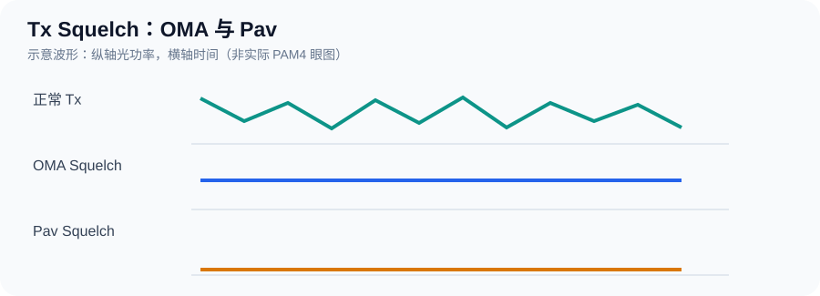
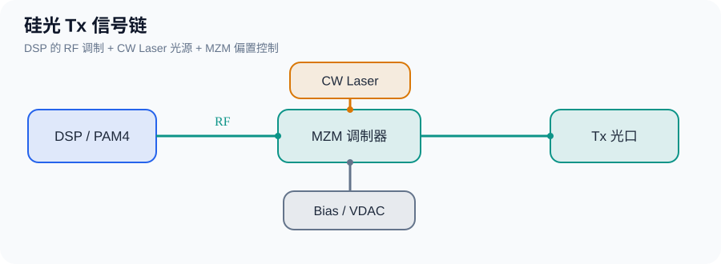
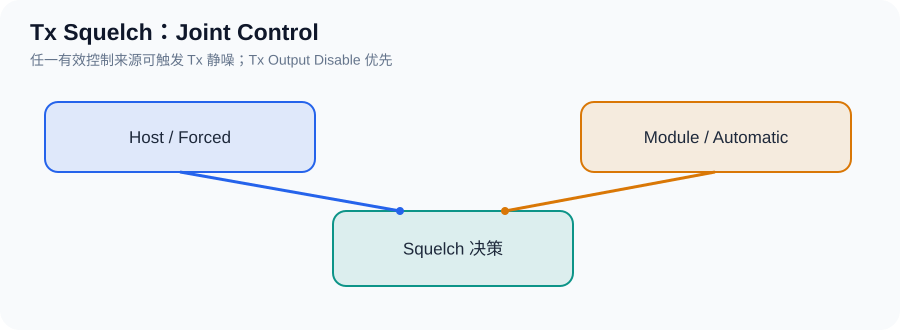
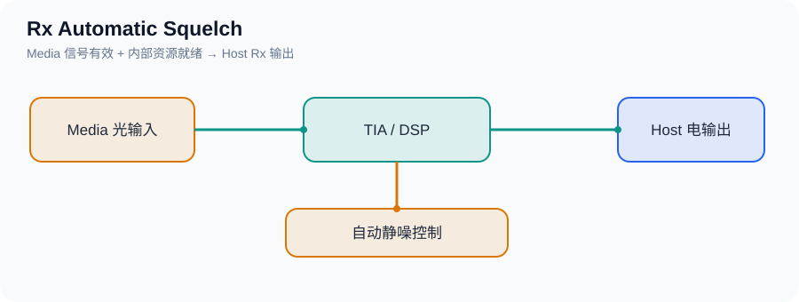
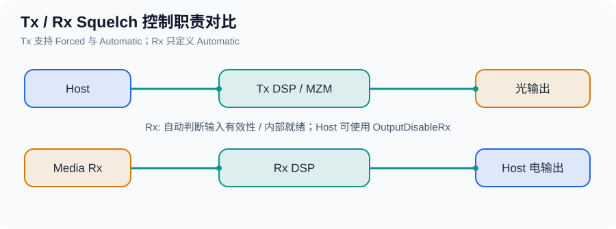

# CMIS 5.2 — Tx / Rx Squelch 工作原理

> 协议依据：**OIF-CMIS-05.2 §8.9.2.1–8.9.2.2**（PDF 第 167–168 页）。本笔记以常规 Data Path 光模块为主；图中的 DSP/MZM 控制路径是工程示意，不是 CMIS 对内部硬件的强制实现。

## 一、Tx Squelch：OMA 与 Pav（怎么静噪）

**Tx Squelch** 使 Media Side 的光输出进入 *Quiescent（静默）* 状态。CMIS 允许通过降低 **OMA** 或降低 **Pav** 实现。

| 术语 | 含义 | 关注点 |
|---|---|---|
| **OMA**（Optical Modulation Amplitude） | 光调制幅度，光功率电平之间的差值；PAM4 常用外层 `OMAouter = P3 − P0` | 光信号变化有多大 |
| **Pav**（Average Optical Power） | 平均光功率 | 平均有多少光 |



| 模式 | 主要控制目标 | 典型结果 |
|---|---|---|
| **OMA Squelch** | 降低光调制幅度 | 不再有有效高速光调制，**可能仍有直流光** |
| **Pav Squelch** | 降低平均光功率 | 输出光功率降低，**不要求必须关闭 Laser** |



**结合公司硅光模块的现有行为**：OMA 模式只静噪高速调制；Pav 模式静噪调制并“关光”。“关光”可能是把 MZM 调到低透射点，也可能涉及 Laser/光开关，**必须查硬件控制路径才能确认**。CMIS 只规定输出效果，不规定必须使用哪种硬件动作。

**相关寄存器**：

| 位置 | 字段 | 含义 |
|---|---|---|
| Lower Memory Byte 26 bit 5 | `SquelchMethodSelect` | `0`=降低 OMA；`1`=降低 Pav，适用于 Host 可选模式 |
| Page 01h Byte 156 bits 5:4 | `SquelchMethodTx` | `00` 不支持；`01` OMA；`10` Pav；`11` Host 可选择 |

## 二、Tx Squelch：Forced 与 Automatic（谁来触发）

- **Forced Squelch**：Host 主动请求静噪。
- **Automatic Squelch**：Module 内部控制器发现 Host 侧没有适合转发到 Media 侧的输入信号时，自动触发静噪。
- **Joint Control** 表示两种触发来源都可能生效，**不是必须两者同时请求**。



| 对比 | Forced | Automatic |
|---|---|---|
| 触发者 | Host | Module |
| 可能场景 | Host 要求停止 Tx 输出调制 | Host 输入丢失、信号无法可靠转发 |
| 解除条件 | Host 撤销强制请求 | 内部判断输入有效，并满足恢复条件 |

> **Tx Output Disable 优先于 Tx Squelch**。即使正在 Squelch，只要 Tx Output Disable 有效，输出禁用仍占优。Tx Disable 后的光功率限值由对应媒体接口标准定义，不能把 CMIS 举例的 `-20 dBm` 当作统一强制值。

固件决策可抽象为（仅示例；需结合实际能力声明与 DPSM）：

```c
bool tx_squelch_required(void)
{
    return host_forced_squelch ||
           (auto_squelch_enabled && host_signal_invalid);
}
```

## 三、Rx Squelch：Automatic（接收侧怎么静噪）

**Rx Squelch** 作用于模块输出给 Host 的**电信号**，不是 Media Side 的光输出。当模块没有适合转发的 Media Rx 输入信号时，内部控制器自动让 Rx 电输出进入 Quiescent 状态。



| 对比项 | Tx Squelch | Rx Squelch |
|---|---|---|
| 作用输出 | Media Side 光输出 | Host Side 电输出 |
| 触发来源 | Forced + Automatic | **仅模块内部 Automatic** |
| 关注的输入 | Host 侧输入 | Media 侧输入 |
| 输出静默方法 | 降低 OMA 或 Pav | 电输出 Quiescent |

**关键规定**：CMIS 5.2 **没有 `OutputSquelchForceRx`**。Host 可以**禁用自动 Rx Squelch**（前提是支持该控制），但不能通过标准 Forced Rx Squelch 位直接请求静噪；如果想主动禁用 Rx 电输出，应使用 `OutputDisableRx`。

**为什么恢复时不能立刻放开？** 一条 Rx 输出可能依赖多个输入 Lane。CMIS 要求相关 Rx 输入都有效、内部资源初始化完毕且能够转发稳定信号后，才解除静噪，避免 Link Flap。实际判断可能用到 LOS、CDR Lock、DSP Ready 等，但 **CMIS 并未规定统一的判断组合**。

**相关寄存器（按 Host Lane）**：

| 位置 | 字段 | 含义 |
|---|---|---|
| Page 10h Byte 139 bit 0–7 | `AutoSquelchDisableRx<N>` | `0`=自动静噪启用；`1`=自动静噪禁用 |
| Page 10h Byte 138 bit 0–7 | `OutputDisableRx<N>` | `0`=输出启用；`1`=输出禁用 |
| Page 01h Byte 156 bit 2 | `AutoSquelchDisableRxSupported` | 是否允许 Host 禁用 Rx 自动静噪 |
| Page 01h Byte 156 bit 1 | `OutputDisableRxSupported` | 是否允许 Host 禁用 Rx 输出 |

> **与 Tx 不同**：CMIS 5.2 对 Rx Output Disable 与 Rx Squelch 的静噪方法和结果特性**未定义相互优先级**，不要直接沿用 Tx 的优先级描述。

简化示例：

```c
bool rx_auto_squelch_required(void)
{
    return auto_squelch_enabled &&
           (!media_signal_valid || !rx_resources_ready);
}
```

## 四、为什么没有 `OutputSquelchForceRx`？

**CMIS 5.2 明确规定：Rx 只有模块内部触发的 Automatic Squelch；没有与 `OutputSquelchForceTx<N>` 对应的 `OutputSquelchForceRx<N>`。** 这是协议事实；规范没有进一步说明制定者为什么省略该控制位（§8.9.2.3）。



从工程设计上可以这样理解：

- **Tx（Host → Media）**：Host 可以要求强制静噪光输出，也可以让模块根据 Host 输入质量自动静噪。
- **Rx（Media → Host）**：模块内部更了解 Media 输入是否有效、CDR / DSP 是否就绪，因此由它决定何时自动静噪、何时恢复。
- **Host 如果只想停止 Rx 电输出**：使用 `OutputDisableRx<N>`（前提是该功能被广告为支持），而不是寻找不存在的 Forced Rx Squelch。

| Host 想达到的目的 | CMIS 5.2 控制方式 | 说明 |
|---|---|---|
| 主动停止 Rx 电输出 | `OutputDisableRx<N> = 1` | 禁用 Host 侧对应 Rx Lane 输出 |
| 重新允许 Rx 电输出 | `OutputDisableRx<N> = 0` | 仍受其他输出条件约束 |
| 输入无效时由模块自动静噪 | `AutoSquelchDisableRx<N> = 0` | 自动静噪启用 |
| 关闭 Rx 自动静噪功能 | `AutoSquelchDisableRx<N> = 1` | 仅在能力支持时可用；不等于强制静噪 |

> **不要混淆 `OutputDisableRx` 和 Forced Rx Squelch。** 两者都可能让 Rx 电输出静默，但前者是实际定义的“输出禁用”控制，后者不是 CMIS 5.2 定义的功能。规范也**没有规定 Rx Output Disable 与 Rx Squelch 在静噪方法和输出特性上的优先级**。

固件里建议单独维护自动静噪条件和 Host 输出禁用请求，再交给统一的 Rx 输出控制逻辑处理；不要虚构 `OutputSquelchForceRx` 寄存器。

## 五、固件调试速查

| 现象 | 优先检查 |
|---|---|
| Tx 有光但没有高速数据 | 是否为 OMA Squelch；DSP 调制是否被静噪 |
| Tx 平均光功率很低 | 是否为 Pav Squelch 或 Tx Output Disable；确认 MZM / Laser 实际动作 |
| Host 未强制静噪，Tx 却静默 | 模块 Automatic Squelch、Host 输入有效性、DPSM |
| Rx 有入光但 Host 无电信号 | Rx Auto Squelch、LOS、CDR/DSP、内部资源 Ready、`OutputDisableRx` |
| Rx 信号恢复后 Link Flap | 是否过早解除静噪；关联 Lane/内部资源是否全部稳定 |

**速记**：Tx 的 **OMA/Pav** 回答“怎么静噪”，**Forced/Automatic** 回答“谁触发”；Rx 仅有 **Automatic Squelch**，重点是避免把无效/不稳定的接收信号输出给 Host。
